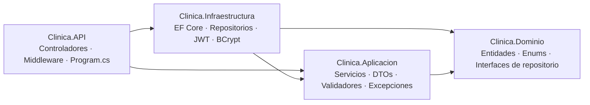
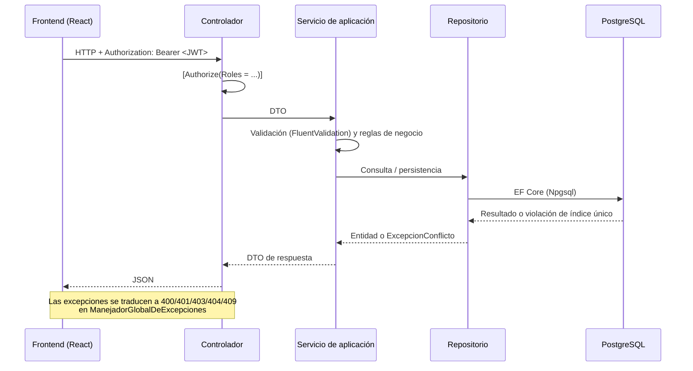

# MiniSistema MAE — Gestión de turnos para clínicas


Sistema web full stack para administrar la agenda de una clínica: pacientes,
profesionales, horarios de atención y turnos, con tres roles (Administrador,
Profesional y Paciente) y autorización aplicada en el backend.

Se desarrolló como prueba técnica para MAE Software. La regla central de
cualquier sistema de turnos —**un profesional no puede tener dos turnos
activos en la misma fecha y horario**— se resuelve en dos niveles: en la
capa de aplicación, con un mensaje claro, y en PostgreSQL con un índice único
parcial que protege ante condiciones de carrera.

---

## Contenido

- [Características](#características)
- [Stack tecnológico](#stack-tecnológico)
- [Arquitectura](#arquitectura)
- [Estructura del proyecto](#estructura-del-proyecto)
- [Requisitos previos](#requisitos-previos)
- [Instalación y ejecución local](#instalación-y-ejecución-local)
- [Variables de entorno](#variables-de-entorno)
- [Usuarios de prueba](#usuarios-de-prueba)
- [API REST](#api-rest)
- [Reglas de negocio](#reglas-de-negocio)
- [Seguridad](#seguridad)
- [Tests](#tests)
- [Despliegue](#despliegue)
- [Decisiones técnicas](#decisiones-técnicas)
- [Uso de inteligencia artificial](#uso-de-inteligencia-artificial)
- [Mejoras futuras](#mejoras-futuras)
- [Autor](#autor)

---

## Características

**Gestión de la clínica (Administrador)**

- Alta, edición y eliminación de pacientes (nombre, apellido, teléfono, obra social, email).
- Alta y edición de profesionales con cuenta de acceso propia (usuario y contraseña).
- Desactivación y reactivación de profesionales: un profesional desactivado no puede iniciar sesión ni recibir turnos nuevos, pero conserva su historial.
- Eliminación definitiva de profesionales solo si llevan 7 días o más desactivados y no tienen turnos asociados.
- Creación, edición, cancelación y cambio de estado de cualquier turno.
- Listado de turnos con filtros por profesional, fecha y estado.

**Agenda y disponibilidad**

- Duración de turno configurable por profesional (entre 5 y 180 minutos).
- Días y franjas de atención por profesional, con varios bloques por día (por ejemplo, corte al mediodía).
- Si un profesional no configuró horarios, se usa el horario general de la clínica (07:00 a 21:00).
- Grilla de horarios disponibles calculada en el backend a partir de la duración, los bloques de atención y los turnos ya ocupados.
- Estados de turno: `Pendiente`, `Confirmado`, `Cancelado` y `Atendido`.

**Profesional**

- Ve únicamente sus propios turnos.
- Marca sus turnos como `Atendido` o `Cancelado`.
- Configura su propia duración de turno y sus horarios de atención.

**Paciente (autogestión)**

- Acceso con nombre, apellido y DNI, sin contraseña (ver [Decisiones técnicas](#decisiones-técnicas)).
- Pide, reprograma y cancela sus propios turnos eligiendo de la grilla de horarios disponibles.
- Actualiza sus datos de contacto desde su perfil.

**Panel de inicio**

- Resumen con totales de turnos por estado, calculado según el rol de quien consulta.
- Profesionales y pacientes ven además sus próximos 5 turnos no cancelados.

---

## Stack tecnológico

| Capa | Tecnologías |
|---|---|
| **Frontend** | React 19, TypeScript, Vite, Mantine (core, dates, form, modals, notifications), React Router 7, Axios, Day.js, Tabler Icons, oxlint |
| **Backend** | C# / .NET 10, ASP.NET Core Web API, Entity Framework Core 10, FluentValidation, JWT Bearer, BCrypt.Net, Swagger (Swashbuckle) |
| **Base de datos** | PostgreSQL 16 (Npgsql) |
| **Tests** | xUnit, Moq, EF Core SQLite en memoria, coverlet |
| **Infraestructura** | Docker (imagen multi-stage del backend), Docker Compose (PostgreSQL local) |
| **Despliegue** | Vercel (frontend), Render (backend), Supabase (PostgreSQL) |

---

## Arquitectura

El backend sigue **Clean Architecture** en cuatro proyectos. Las dependencias
apuntan hacia el dominio, que no depende de ningún otro proyecto.



| Proyecto | Responsabilidad |
|---|---|
| `Clinica.Dominio` | Entidades (`Paciente`, `Profesional`, `Turno`, `Usuario`, `BloqueHorarioProfesional`), enums de estado y rol, contratos de repositorio. |
| `Clinica.Aplicacion` | Casos de uso (`ServicioTurnos`, `ServicioPacientes`, etc.), DTOs, validadores FluentValidation, excepciones de negocio e interfaces de servicios externos (tokens, hashing, usuario actual). |
| `Clinica.Infraestructura` | `ClinicaDbContext`, configuraciones y migraciones de EF Core, repositorios, seed de datos, generación de JWT y hashing con BCrypt. |
| `Clinica.API` | Controladores REST, middleware global de excepciones, configuración de CORS, autenticación y Swagger. |
| `Clinica.Tests` | Tests de los servicios de aplicación. |

Se usa el patrón Repository con interfaces específicas por entidad, sin
repositorio genérico ni Unit of Work aparte: el `DbContext` ya cumple ese rol.

### Flujo de una solicitud



### Frontend

Organizado por responsabilidad:

| Carpeta | Contenido |
|---|---|
| `paginas/` | Una pantalla por archivo: login, acceso de paciente, panel, turnos, mis turnos, pacientes y profesionales. |
| `componentes/` | Layout principal, editor de horarios de atención, badge de estado y tarjetas de estadísticas. |
| `servicios/` | Cliente Axios con interceptores (adjunta el JWT y redirige al login ante un `401`) y un servicio por recurso de la API. |
| `modelos/` | Tipos TypeScript que reflejan los DTOs del backend. |
| `contexto/` y `hooks/` | Sesión de autenticación y carga de horarios disponibles. |
| `rutas/` | `RutaProtegida`, guarda de rutas por sesión y por rol. |

---

## Estructura del proyecto

```text
MinisistemaMAE/
├── Backend/
│   ├── Clinica.slnx
│   ├── Dockerfile
│   ├── .env.example
│   ├── Clinica.API/              # Controllers/, Middleware/, Seguridad/, Program.cs
│   ├── Clinica.Aplicacion/       # DTOs/, Servicios/, Validadores/, Excepciones/, Interfaces/
│   ├── Clinica.Dominio/          # Entidades/, Enumeraciones/, Interfaces/
│   ├── Clinica.Infraestructura/  # Persistencia/ (Contexto, Configuraciones, Migraciones,
│   │                             # Repositorios, SeedDeDatos), Seguridad/, Configuracion/
│   └── Clinica.Tests/            # Servicios/, Comunes/
├── Frontend/
│   ├── src/                      # paginas/, componentes/, servicios/, modelos/, contexto/,
│   │                             # hooks/, rutas/, utilidades/
│   ├── .env.example
│   ├── vercel.json
│   └── package.json
├── docker-compose.yml            # PostgreSQL para desarrollo local
├── DOCUMENTACION_IA.md
└── README.md
```

---

## Requisitos previos

| Herramienta | Versión |
|---|---|
| .NET SDK | 10 |
| Node.js | 20 o superior |
| PostgreSQL | 16 (o Docker para levantarlo con `docker compose`) |

---

## Instalación y ejecución local

### 1. Clonar el repositorio

```bash
git clone https://github.com/EnzoDalmasso/MinisistemaMAE.git
cd MinisistemaMAE
```

### 2. Base de datos

Con Docker, desde la raíz del proyecto:

```bash
docker compose up -d
```

Levanta PostgreSQL 16 en el puerto **5433** del host (no 5432, para no chocar
con una instalación local). Las credenciales coinciden con las de
`appsettings.Development.json`, así que no hace falta configurar nada más.

### 3. Backend

```bash
cd Backend
dotnet run --project Clinica.API
```

Al iniciar, la API **aplica las migraciones pendientes y carga datos de
demostración** si la base está vacía. Queda disponible en
`http://localhost:5260`, con Swagger en `http://localhost:5260/swagger`
(solo en entorno `Development`).

### 4. Frontend

```bash
cd Frontend
npm install
cp .env.example .env
npm run dev
```

Queda disponible en `http://localhost:5173`.

### Scripts del frontend

| Comando | Descripción |
|---|---|
| `npm run dev` | Servidor de desarrollo de Vite. |
| `npm run build` | Chequeo de tipos (`tsc -b`) y build de producción. |
| `npm run lint` | Análisis estático con oxlint. |
| `npm run preview` | Sirve el build generado. |

---

## Variables de entorno

### Backend

ASP.NET Core mapea variables de entorno a la configuración usando `__` como
separador de sección. Referencia completa en
[`Backend/.env.example`](Backend/.env.example).

| Variable | Descripción |
|---|---|
| `ConnectionStrings__BaseDeDatos` | Cadena de conexión a PostgreSQL. |
| `Jwt__Clave` | Clave de firma de los JWT (larga y aleatoria en producción). |
| `Jwt__Emisor` / `Jwt__Audiencia` | Emisor y audiencia validados en cada token. |
| `Jwt__ExpiracionMinutos` | Vigencia del token (120 por defecto). |
| `ORIGEN_FRONTEND` | Origen permitido por CORS. Admite varios separados por coma. |
| `DatosSemilla__ContrasenaAdministrador` / `DatosSemilla__ContrasenaProfesional` | Contraseñas de los usuarios de demo (opcionales). |

En desarrollo local no hace falta definir ninguna:
`appsettings.Development.json` trae valores de demo. Para cambiar algo puntual
sin tocar ese archivo (por ejemplo, otro puerto de PostgreSQL), se puede crear
`Backend/Clinica.API/appsettings.Local.json`, que se carga solo en
`Development` y está excluido del repositorio.

### Frontend

| Variable | Descripción |
|---|---|
| `VITE_API_URL` | URL base de la API, sin barra final (por defecto `http://localhost:5260/api`). |

---

## Usuarios de prueba

Con una base de datos vacía, el seed crea automáticamente:

| Usuario | Rol | Acceso |
|---|---|---|
| `administrador` | Administrador | `/login` |
| `profesional` | Profesional (vinculado a un profesional de ejemplo) | `/login` |

El administrador puede dar de alta profesionales adicionales en cualquier
momento desde su propio panel, definiendo usuario y contraseña para cada uno.

El rol Paciente no necesita usuario ni contraseña: se ingresa desde
`/acceso-paciente` con nombre, apellido y DNI, y la cuenta se crea en el
momento si no existía.

El seed también carga profesionales, pacientes y turnos en distintos estados,
para no arrancar con las pantallas vacías.

---

## API REST

Todos los endpoints, salvo los de autenticación, requieren un JWT en el header
`Authorization: Bearer <token>`. La documentación interactiva está en Swagger.

### Autenticación — `/api/autenticacion`

| Método | Ruta | Acceso | Descripción |
|---|---|---|---|
| `POST` | `/iniciar-sesion` | Público | Login de Administrador y Profesional. |
| `POST` | `/acceso-paciente` | Público | Acceso o alta del paciente con nombre, apellido y DNI. |

### Turnos — `/api/turnos`

| Método | Ruta | Acceso | Descripción |
|---|---|---|---|
| `GET` | `/` | Autenticado | Lista turnos. Filtros: `profesionalId`, `fecha`, `estado`. Cada rol ve solo lo que le corresponde. |
| `GET` | `/{id}` | Autenticado | Detalle de un turno (con verificación de dueño). |
| `GET` | `/horarios-disponibles` | Autenticado | Horarios libres de un profesional en una fecha (`profesionalId`, `fecha`, `excluirTurnoId` opcional). |
| `POST` | `/` | Administrador, Paciente | Crea un turno. |
| `PUT` | `/{id}` | Administrador | Modifica un turno. |
| `PATCH` | `/{id}/cancelar` | Administrador, Paciente | Cancela un turno. |
| `PUT` | `/{id}/reprogramar` | Paciente | Cambia fecha y horario de un turno propio. |
| `PATCH` | `/{id}/estado` | Administrador, Profesional | Cambia el estado del turno. |

### Pacientes — `/api/pacientes`

| Método | Ruta | Acceso | Descripción |
|---|---|---|---|
| `GET` | `/` | Administrador | Lista pacientes. |
| `POST` | `/` | Administrador | Crea un paciente. |
| `PUT` | `/{id}` | Administrador | Modifica un paciente. |
| `DELETE` | `/{id}` | Administrador | Elimina un paciente sin turnos asociados. |
| `GET` | `/mi-perfil` | Paciente | Datos del paciente autenticado. |
| `PUT` | `/mi-perfil` | Paciente | Actualiza los datos de contacto propios. |

### Profesionales — `/api/profesionales`

| Método | Ruta | Acceso | Descripción |
|---|---|---|---|
| `GET` | `/` | Autenticado | Lista profesionales (nombre y especialidad). |
| `POST` | `/` | Administrador | Crea un profesional con su cuenta de acceso. |
| `PUT` | `/{id}` | Administrador | Modifica un profesional. |
| `PATCH` | `/{id}/duracion-turno` | Administrador, Profesional (propio) | Cambia la duración de turno. |
| `PUT` | `/{id}/horarios` | Administrador, Profesional (propio) | Reemplaza los bloques de atención. |
| `PATCH` | `/{id}/desactivar` | Administrador | Desactiva al profesional y a su usuario. |
| `PATCH` | `/{id}/reactivar` | Administrador | Reactiva al profesional y a su usuario. |
| `DELETE` | `/{id}` | Administrador | Eliminación definitiva (requiere 7+ días desactivado y sin turnos). |

### Panel — `/api/panel`

| Método | Ruta | Acceso | Descripción |
|---|---|---|---|
| `GET` | `/resumen` | Autenticado | Totales de turnos por estado según el rol; próximos turnos para profesional y paciente. |

### Ejemplo: iniciar sesión

```http
POST /api/autenticacion/iniciar-sesion
Content-Type: application/json

{
  "nombreUsuario": "administrador",
  "contrasena": "<contraseña>"
}
```

```json
{
  "token": "eyJhbGciOi...",
  "expiraEn": "2026-09-12T14:00:00Z",
  "nombreUsuario": "administrador",
  "rol": "Administrador",
  "profesionalId": null,
  "pacienteId": null,
  "nombreCompleto": null
}
```

### Formato de errores

Todos los errores comparten el mismo formato, incluidos los de model binding:

```json
{
  "mensaje": "Los datos enviados no son válidos.",
  "errores": {
    "Fecha": ["La fecha del turno no puede ser anterior a hoy."]
  }
}
```

| Código | Origen |
|---|---|
| `400` | Validación (FluentValidation o JSON inválido). |
| `401` | Credenciales inválidas o token ausente/vencido. |
| `403` | El rol o el dueño del recurso no coincide. |
| `404` | Recurso inexistente. |
| `409` | Conflicto de negocio: horario ocupado, profesional inactivo, edición concurrente, etc. |
| `500` | Error no controlado; se registra en el log y no se exponen detalles. |

Los enums viajan como texto (`"Pendiente"`, no `1`).

---

## Reglas de negocio

### Prevención de turnos duplicados

1. **Aplicación:** antes de guardar, `ServicioTurnos` verifica que el
   profesional atienda ese día y horario y que no exista otro turno activo en
   el mismo slot. Si lo hay, responde `409` con un mensaje claro.
2. **Base de datos:** el índice único parcial `IX_Turnos_Disponibilidad`
   sobre `(ProfesionalId, Fecha, Horario)` excluye los turnos cancelados. Si
   dos requests llegan casi al mismo tiempo, PostgreSQL rechaza el segundo
   insert y el repositorio lo traduce a `409`.

Además, la tabla `Turnos` usa la columna de sistema `xmin` de PostgreSQL como
token de **concurrencia optimista**: si dos usuarios editan el mismo turno a la
vez, el segundo recibe un conflicto en lugar de pisar los cambios del primero.

### Estados y permisos

- Un turno **cancelado libera el horario**; pendiente, confirmado y atendido lo bloquean.
- El turno que carga el administrador arranca en `Pendiente`; el que pide el paciente queda `Confirmado`, porque eligió de una grilla con disponibilidad real.
- El paciente no puede reprogramar un turno cancelado o ya atendido.
- El profesional solo puede marcar sus turnos como `Atendido` o `Cancelado`.

---

## Seguridad

- **Autenticación JWT** firmada con clave simétrica; se validan emisor, audiencia, firma y vigencia (tolerancia de reloj de 1 minuto).
- **Contraseñas hasheadas con BCrypt**; nunca se almacenan en texto plano.
- **Autorización por rol en el backend** con `[Authorize(Roles = ...)]` en cada acción. Las guardas de rutas del frontend son solo de navegación.
- **Verificación de dueño del recurso:** profesionales y pacientes se identifican por los claims del token, no por datos enviados por el cliente. Si un paciente envía otro `PacienteId` al crear un turno, se ignora y se usa el de su sesión.
- **CORS restringido** al origen configurado en `ORIGEN_FRONTEND`, sin comodines.
- **Validación de entrada** con FluentValidation en todos los DTOs de escritura.
- **Errores controlados:** el middleware global no expone stack traces ni detalles internos.
- **Sin secretos reales en el repositorio:** los overrides locales (`appsettings.Local.json`, `.env`) están en `.gitignore`.
- **Usuarios desactivados** no pueden iniciar sesión.

> **Limitación conocida:** el acceso del paciente con nombre, apellido y DNI
> es una simplificación deliberada para la demo. Cualquiera que conozca el DNI
> de otra persona podría acceder a su cuenta. Ver [Mejoras futuras](#mejoras-futuras).

---

## Tests

```bash
cd Backend
dotnet test
```

El proyecto `Clinica.Tests` contiene **47 tests** de xUnit sobre los servicios
de aplicación, ejecutados contra EF Core con SQLite en memoria (y Moq para las
dependencias):

| Archivo | Tests |
|---|---|
| `ServicioTurnosTests` | 24 |
| `ServicioProfesionalesTests` | 11 |
| `ServicioPacientesTests` | 9 |
| `ServicioAutenticacionTests` | 3 |

Cubren las reglas críticas: disponibilidad de horarios, turnos duplicados,
permisos por rol y por dueño, estados de turno y ciclo de vida de los
profesionales.

---

## Despliegue

| Componente | Plataforma | Notas |
|---|---|---|
| Frontend | Vercel | `vercel.json` reescribe todas las rutas a `index.html` para que funcione React Router. |
| Backend | Render | Se construye con `Backend/Dockerfile`. |
| Base de datos | Supabase | PostgreSQL administrado. |

El `Dockerfile` usa un build multi-stage (SDK para compilar, runtime de
ASP.NET Core para la imagen final) y escucha en el puerto definido por la
variable `PORT`, con `8080` como valor por defecto:

```bash
cd Backend
docker build -t clinica-api .
docker run -p 8080:8080 --env-file .env clinica-api
```

El archivo `.env` debe crearse a partir de `Backend/.env.example`.

---

## Decisiones técnicas

- **Sin contraseña para el paciente:** decisión explícita para la demo. Internamente reutiliza la misma infraestructura de JWT y BCrypt (el DNI funciona como usuario y contraseña); no es un mecanismo paralelo sin hashear.
- **Doble validación de disponibilidad:** la verificación en la aplicación da un mensaje claro; el índice único parcial garantiza la consistencia ante concurrencia.
- **Horarios por profesional con respaldo general:** si un profesional no configuró bloques de atención, se usa el horario de la clínica para no dejarlo sin agenda.
- **Baja lógica antes que eliminación:** los profesionales se desactivan conservando su historial; la eliminación definitiva tiene un período de espera de 7 días.
- **Sin Unit of Work ni repositorio genérico:** el `DbContext` ya cumple el rol del primero, y cada entidad tiene consultas propias.
- **Mapeo DTO ↔ entidad manual**, sin AutoMapper: el dominio es chico y no lo justifica.
- **Roles como enum**, no como tabla: el conjunto es fijo.
- **Migraciones automáticas al iniciar:** simplifica el despliegue de la demo; el seed solo se ejecuta si no hay usuarios.

---

## Uso de inteligencia artificial

Se usó Claude Code como asistente durante el desarrollo (arquitectura,
generación y refactor de código, tests, documentación y corrección de bugs).
Todo el resultado fue revisado, probado en vivo y corregido a mano cuando hizo
falta. Detalle completo en [DOCUMENTACION_IA.md](DOCUMENTACION_IA.md).

---

## Mejoras futuras

- Contraseña real para el acceso del paciente (la mejora de seguridad más importante pendiente).
- Paginación en los listados.
- Refresh tokens y recuperación de contraseña.
- Notificaciones y recordatorios por email.
- Tests de integración end-to-end sobre el pipeline HTTP completo.

---

## Autor

**Enzo Dalmasso**

- GitHub: [github.com/EnzoDalmasso](https://github.com/EnzoDalmasso)
- Portfolio: [porfolio-enzo-dalmasso.vercel.app](https://porfolio-enzo-dalmasso.vercel.app/)
